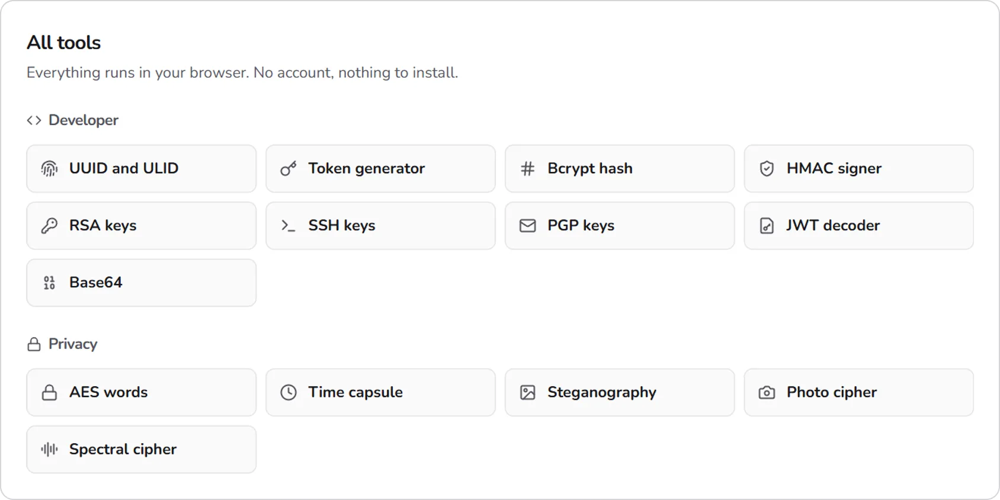
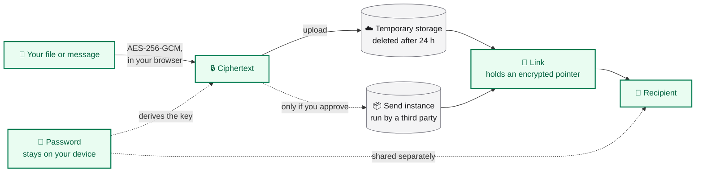
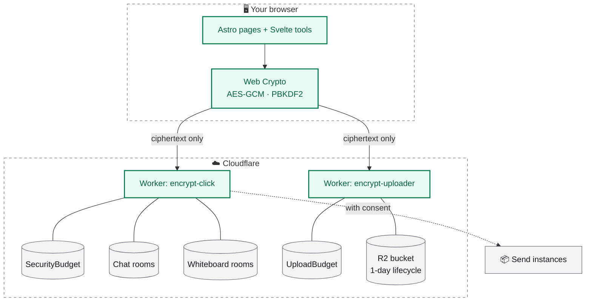

<div align="center">

<picture>
  <source media="(prefers-color-scheme: dark)" srcset="docs/readme/hero-dark.webp">
  
</picture>

<br>

**Free, open-source privacy tools that run in your browser.**<br>
Share encrypted files, chat, draw and use a dozen crypto utilities. No account, no trackers.

<br>

[**🌐 Open encrypt.click**](https://encrypt.click) &nbsp;·&nbsp; [🛡️ Security](https://encrypt.click/security) &nbsp;·&nbsp; [🚀 Run it locally](#-run-it-locally) &nbsp;·&nbsp; [🤝 Contribute](CONTRIBUTING.md)

<br>


</div>

<br>

## ✨ What it does

<table>
<tr>
<td width="25%" align="center" valign="top">
<picture>
  <source media="(prefers-color-scheme: dark)" srcset="docs/readme/art-share-dark.webp">
  
</picture>
<br><b>Share</b><br>
Encrypt a file or message in your browser, then send the link and the password separately. Up to 90 MB, kept for 24 hours.
</td>
<td width="25%" align="center" valign="top">
<picture>
  <source media="(prefers-color-scheme: dark)" srcset="docs/readme/art-chat-dark.webp">
  
</picture>
<br><b>Chat</b><br>
End-to-end encrypted rooms with calls, screen sharing and file drops. The server keeps no message history.
</td>
<td width="25%" align="center" valign="top">
<picture>
  <source media="(prefers-color-scheme: dark)" srcset="docs/readme/art-whiteboard-dark.webp">
  
</picture>
<br><b>Whiteboard</b><br>
A shared canvas, synced live and encrypted end to end. Pressure-sensitive pen, shapes, sticky notes and a laser pointer.
</td>
<td width="25%" align="center" valign="top">
<picture>
  <source media="(prefers-color-scheme: dark)" srcset="docs/readme/art-tools-dark.webp">
  
</picture>
<br><b>14 tools</b><br>
Bcrypt, JWT, RSA, SSH and PGP keys, time-lock capsules, steganography and more. All of them run locally.
</td>
</tr>
</table>

## 📸 See it in action

### Share a secret with a link and a password

<picture>
  <source media="(prefers-color-scheme: dark)" srcset="docs/readme/home-dark.webp">
  
</picture>

*Encryption happens in the browser. The link and the password travel by different routes, and the link cannot be opened without the password.*

### Talk in a room that forgets

<picture>
  <source media="(prefers-color-scheme: dark)" srcset="docs/readme/chat-dark.webp">
  
</picture>

*Participants get random aliases, shown in each viewer's own language. Messages disappear on a timer, or live only in participant browsers.*

### Sketch together, privately

<picture>
  <source media="(prefers-color-scheme: dark)" srcset="docs/readme/whiteboard-dark.webp">
  
</picture>

*The heart and the two waves were drawn with a pen: line width follows pressure from a hairline to a bold stroke.*

### Everyday crypto, without sending anything anywhere

<picture>
  <source media="(prefers-color-scheme: dark)" srcset="docs/readme/tools-dark.webp">
  
</picture>

## 🛡️ Privacy model



| Runs in your browser | The server is involved |
| --- | --- |
| Encryption and decryption, key generation, every standalone tool | Ciphertext upload, short links, the drand proxy, realtime rooms, TURN credentials for calls |

- **No history on the server.** The default chat mode keeps encrypted envelopes in participant browsers; disappearing modes keep nothing.
- **Calls never leak addresses.** Media runs over a TURN relay only, so participants never see each other's IP address.
- **Names carry no information.** Participant names are random aliases rendered in each viewer's language, so a name never reveals which language someone uses.
- **Third-party hosting is named.** If encrypt.click's own storage is full, the share form names the exact Send instance and asks before it uploads anything. Chat falls back to Send on its own, for files up to 50 MB.

The full write-up is at [encrypt.click/security](https://encrypt.click/security). Security reports: [security.txt](https://encrypt.click/.well-known/security.txt).

## 🧰 All tools

| 🔐 Privacy | 🛠️ Developer |
| --- | --- |
| **AES words**: encrypted payloads as easy-to-copy groups of words | **UUID and ULID** generator |
| **Time capsule**: time-lock encryption with [drand](https://drand.love/) | **Token generator** |
| **Steganography**: an encrypted message hidden in a PNG | **Bcrypt** hash and verify |
| **Photo cipher**: a hidden message that survives chat-app compression | **HMAC** signer |
| **Spectral cipher**: an image hidden in a WAV spectrogram | **RSA**, **SSH** and **PGP** key pairs |
| | **JWT** decoder |
| | **Base64** |

## 🌍 Languages

🇬🇧 English &nbsp;·&nbsp; 🇨🇿 Čeština &nbsp;·&nbsp; 🇩🇪 Deutsch &nbsp;·&nbsp; 🇪🇸 Español &nbsp;·&nbsp; 🇫🇷 Français &nbsp;·&nbsp; 🇸🇰 Slovenčina &nbsp;·&nbsp; 🇵🇱 Polski

## 🚀 Run it locally

Node 24.21 (`.nvmrc`) and pnpm 10 through corepack.

```bash
pnpm install
pnpm dev       # the site at http://localhost:4321, without chat and whiteboard rooms
pnpm build
pnpm preview   # the built Worker at http://localhost:4321, rooms included
pnpm test      # unit tests
pnpm check     # astro check
```

## 🏗️ How it is built

Astro 7 pages, Svelte 5 for the interactive tools, Tailwind CSS 4, one Cloudflare Worker with Durable Objects for the rooms (PartyServer) and a second small Worker for ciphertext uploads.



- **Design system.** Tokens and component classes live in `src/styles/global.css`. Every page uses only those.
- **Languages.** English without a prefix, `cs`, `de`, `es`, `fr`, `sk` and `pl` under a path prefix. The Worker picks the language from `Accept-Language` on the first visit and from the `ec-lang` cookie once you choose one in the menu, so it works without JavaScript. Shared links keep their language. All strings live in `src/locales/*.json`.
- **Crypto.** `src/lib/crypto.ts`, `src/lib/chatCrypto.ts`, `src/lib/ghost/` and the room code in `party/`. Tests in `tests/`.
- **Whiteboard.** Drawing uses `@quickdrawjs/core` with a small patch in `patches/` that makes pen pressure drive the stroke width. The tests in `tests/pen-pressure.test.ts` fail if the patch is lost.
- **Transfer limits.** Upload sizes and timeouts are defined once in `src/lib/httpLimits.ts`, and both Workers read them from there.

## ☁️ Deploy

Production deploys from GitHub Actions on every push to `main` ([`deploy.yml`](.github/workflows/deploy.yml)), after tests, type check and build. `pnpm run deploy` does the same from a machine logged in with `wrangler login`. The build writes assets to `dist/client` and the Worker config to `dist/server/wrangler.json`; `scripts/merge-wrangler-routes.mjs` copies the custom domains and the `run_worker_first` patterns from `wrangler.toml` into it. Deploy assets and Worker together, because the CSP hashes in `_headers` are computed from the built scripts.

Repository secrets for the workflow:

| Secret | Purpose |
| --- | --- |
| `CLOUDFLARE_API_TOKEN` | API token from the "Edit Cloudflare Workers" template |
| `CLOUDFLARE_ACCOUNT_ID` | Account id |

Worker secrets:

| Secret | Purpose |
| --- | --- |
| `ROOM_TURN_SECRET` | Random, at least 32 bytes. Signs the short-lived TURN grants issued to room participants and keys the per-client request budget hashes. Never expose it as a `PUBLIC_` variable. |
| `TURN_PROVIDER` | `cloudflare` |
| `CLOUDFLARE_TURN_TOKEN_ID`, `CLOUDFLARE_TURN_API_TOKEN` | Cloudflare Realtime TURN key |
| `RATE_LIMIT_SECRET` | Optional, separate key for request budget hashing |

Wrangler loads `.env` automatically, so do not name a local variable `CF_API_TOKEN` or `CLOUDFLARE_API_TOKEN` unless it is the account token.

Durable Object classes: `SECURITY_BUDGET` (shared per-minute request budgets; the expensive APIs fail closed if it is unreachable), `CHAT` and `WHITEBOARD` (rooms at `/parties/main/<room>` and `/parties/whiteboard/<room>`). The per-client and global ceilings are in `src/worker.ts`. `/api/*` and `/parties/*` reject cross-site browser requests.

### Upload Worker

Ciphertext uploads go to a separate Worker in [`workers/upload`](workers/upload) at `upload.encrypt.click`. It streams each file into an R2 bucket and refuses anything that does not start with the encrypt.click signature, comes from another origin or exceeds the size limit.

```bash
pnpm run dev:upload      # local Worker with a simulated bucket
pnpm run deploy:upload   # wrangler deploy for workers/upload
```

- **Bucket.** `encrypt-r2` with a lifecycle rule that deletes objects and aborts incomplete multipart uploads after one day. Downloads are served from the bucket's custom domain, `dl.encrypt.click`. If the bucket lives in the EU jurisdiction, pass `--jurisdiction eu` to every `wrangler r2` command.
- **Cost cap.** A Durable Object (`UploadBudget`) reserves capacity before a single byte is read, so concurrent uploads cannot overshoot: 1000 GB and 500 000 uploads per month, 100 GB per day for everyone, 5 GB per day for one client. Clients are told apart by an IP hash with a salt that is deleted the next day. The constants are at the top of `workers/upload/src/index.ts`, sized to keep R2 under about one dollar a month.
- **When it is full.** The Worker answers 503 (or 429 for one client), and the share form offers to upload to a named Send instance instead. `GET /status` reports current usage.
- **Not capped.** Reads from `dl.encrypt.click` are served by R2 directly, so add a rate-limit rule there and a billing alert at Cloudflare.

## 📝 Operational notes

- Room passwords derive an authorization capability that the relay receives, so it could try to guess a weak password offline. Room creation therefore requires at least 12 characters or the generated passphrase. Without a password the full `#k=…` link carries a random 256-bit secret; never send that link through a shortener.
- TURN credentials are valid for five minutes and are only issued against a signed grant. Set bandwidth quotas and billing alerts at the TURN provider; a request budget cannot cap traffic on an already allocated relay.
- The deployment manifest checked by `integrity-check.js` is a same-origin consistency check, not proof against a compromised host. Pages never contact GitHub from a visitor's browser; the star count is fetched at build time.
- Empty chat rooms delete their stored configuration after seven days.

## 🤝 Contributing

See [`CONTRIBUTING.md`](CONTRIBUTING.md).

## 📄 License

[MIT](LICENSE)

<div align="center">
<br>

<picture>
  <source media="(prefers-color-scheme: dark)" srcset="docs/readme/art-chat-dark.webp">
  
</picture>

**Your privacy is just a click away.**

</div>
