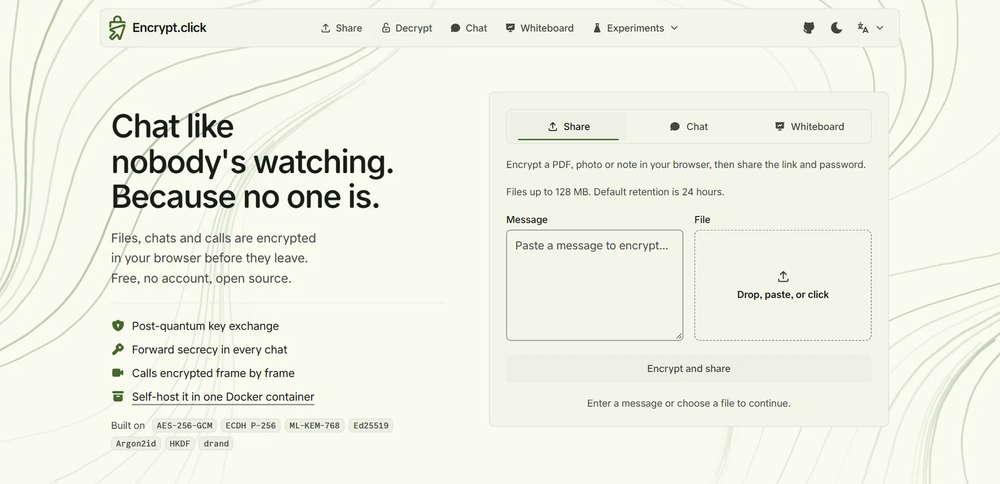

<div align="center">

# Encrypt.click

**Chat like nobody's watching. Because no one is.**

Files, chats and calls are encrypted in your browser before they leave.<br>
Free, no account, open source, and you can run your own copy on Cloudflare in one click or in one Docker container.

[**Open Encrypt.click**](https://encrypt.click) &nbsp;·&nbsp; [Security](https://encrypt.click/security) &nbsp;·&nbsp; [Install the app](https://encrypt.click/install) &nbsp;·&nbsp; [Self-host](docs/self-hosting.md)

[](https://deploy.workers.cloudflare.com/?url=https://github.com/danielsebesta/encrypt)


</div>

<picture>
  <source media="(prefers-color-scheme: dark)" srcset="docs/readme/home-dark.webp">
  
</picture>

## What it does

| | |
| --- | --- |
| **Share and decrypt** | Encrypt a file or a message in your browser and share the link and the password separately. Files up to 128 MB, kept for 1 hour, 1 day or 7 days, or deleted after the first download. Short messages travel inside the link and nothing is stored. Recipients open [`/u`](https://encrypt.click/u) with the link, a QR code, a PNG wrapper or an `.enc` file. |
| **Chat and calls** | End-to-end encrypted rooms with voice and video calls, screen sharing, files, voice messages, replies and reactions. Keep history (each member keeps it encrypted in their own browser and online members send you what you missed) or let every message disappear after 10 seconds to 1 day. The relay stores no messages. |
| **Whiteboard** | A shared canvas, synced live through Yjs and encrypted end to end: pressure-sensitive pen, shapes, sticky notes, pictures, a laser pointer and a board chat. |
| **My rooms** | Save rooms on this device to come back without the password or link. The secrets are wrapped under a key that only your passkey releases (WebAuthn PRF). |
| **Tools** | Chat cipher, time capsule, steganography, photo cipher and image in sound. All of them run locally. |

## Security at a glance

- **Hybrid post-quantum key exchange.** Room keys come from ECDH on P-256 and ML-KEM-768 together, so a future quantum computer alone is not enough.
- **Forward secrecy in every chat.** Message keys are derived once and wiped after use.
- **Signed messages.** Every chat message carries its author's Ed25519 signature.
- **Calls encrypted frame by frame**, always through a TURN relay, so participants never see each other's IP address.
- **Slow-to-guess passwords** with Argon2id, and AES-256-GCM for files, messages and board updates.
- **Verifiable builds.** Every deploy publishes the commit and a hash of every file it serves, signed by GitHub Actions. See [docs/deployment.md](docs/deployment.md#verify-what-is-served).

The full write-up is at [encrypt.click/security](https://encrypt.click/security). Security reports: [security@encrypt.click](mailto:security@encrypt.click). Everything else: [hello@encrypt.click](mailto:hello@encrypt.click).

## Run it locally

Node 24 (see `.nvmrc`) and pnpm 10 through corepack.

```bash
git clone https://github.com/danielsebesta/encrypt.git && cd encrypt
corepack enable
pnpm install
pnpm dev
```

The site is at http://localhost:4321. `pnpm dev` runs without chat and whiteboard rooms; to try those, build and run the Worker locally:

```bash
pnpm build
pnpm preview
```

| Command | What it does |
| --- | --- |
| `pnpm dev` | Dev server with hot reload, without rooms |
| `pnpm preview` | The built Worker, rooms included |
| `pnpm build` | Cloudflare build |
| `pnpm build:node` / `pnpm start:node` | Node build and server |
| `pnpm test` | Unit tests |
| `pnpm check` | Type check |

Copy `.dev.vars.example` to `.dev.vars` to set local secrets.

## Self-host

### Your own copy on Cloudflare

[](https://deploy.workers.cloudflare.com/?url=https://github.com/danielsebesta/encrypt)

The button copies this repository to your GitHub account, creates the R2 bucket and the Durable Objects, asks for the secrets, then builds and deploys to `<name>.<your-subdomain>.workers.dev`. Every push to your copy deploys again, and a small instance fits in the free plan.

1. Enable R2 in the Cloudflare dashboard first. It asks for a payment method even on the free tier, and the deploy cannot create the bucket without it.
2. Press the button and fill in `ROOM_TURN_SECRET`, `RATE_LIMIT_SECRET` and `UPLOAD_PASS_SECRET` with random strings, for example from `openssl rand -hex 32`.
3. For calls, create a TURN key under Realtime → TURN Server and fill in `CLOUDFLARE_TURN_TOKEN_ID` and `CLOUDFLARE_TURN_API_TOKEN`. Without it everything else works and calls do not.

A custom domain goes under the Worker's Settings → Domains & Routes.

### With Docker

One container is a complete instance: pages, uploads, chat and whiteboard rooms and calls.

```bash
git clone https://github.com/danielsebesta/encrypt.git && cd encrypt
docker build -t encrypt-click .
docker run --rm -p 8080:8080 encrypt-click
```

Then open http://localhost:8080. For a public instance with HTTPS and call relays, point a domain at a Linux host:

```bash
docker run -d --name encrypt --restart unless-stopped --network host   -e DOMAIN=encrypt.example.com -e ACME_EMAIL=admin@example.com   -v encrypt-data:/data encrypt-click
```

`docker compose up -d --build` does the same. Configuration, ports, backups and upgrades are in [docs/self-hosting.md](docs/self-hosting.md).

## Documentation

- [Self-hosting](docs/self-hosting.md)
- [Production deployment and verification](docs/deployment.md)

## Contributing

Issues and pull requests are welcome. Run `pnpm test`, `pnpm check` and `pnpm build` before opening one. Every user-facing string goes into all files in `src/locales/`.

## License

[MIT](LICENSE)
