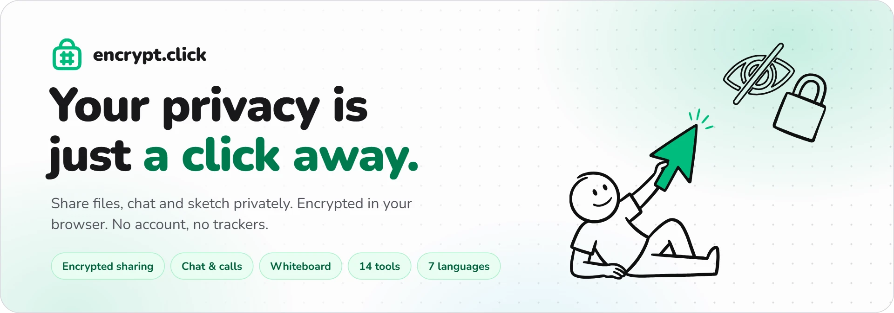
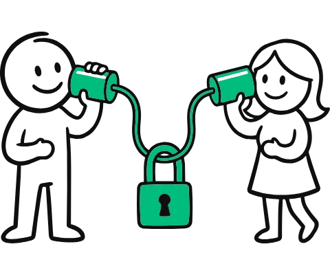
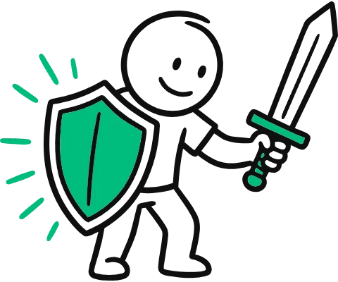
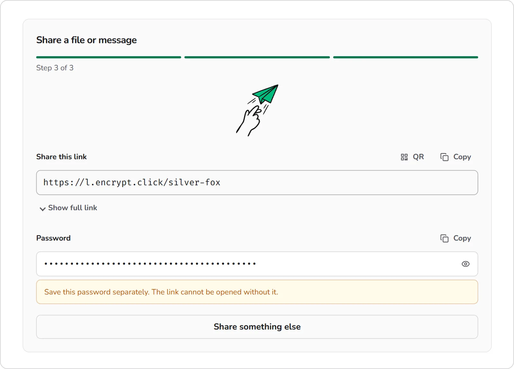
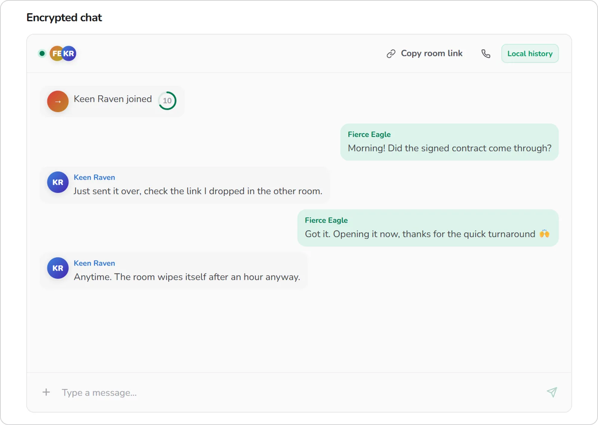
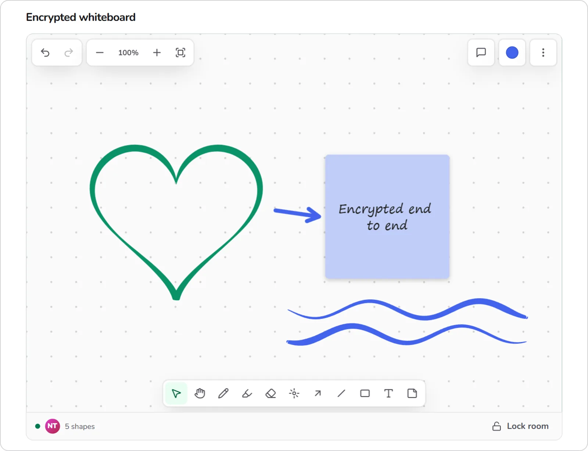
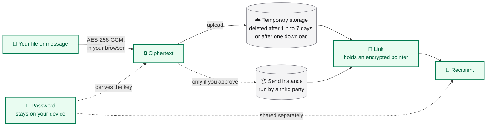
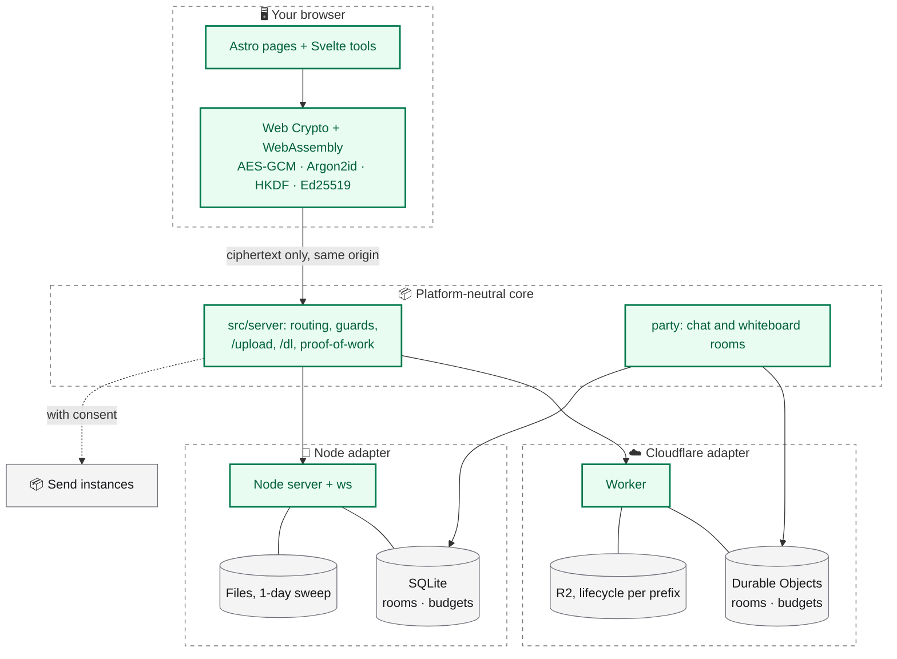

<div align="center">

<picture>
  <source media="(prefers-color-scheme: dark)" srcset="docs/readme/hero-dark.webp">
  
</picture>

<br>

**Free, open-source privacy tools that run in your browser.**<br>
Share encrypted files, chat, draw and hide messages in images, audio or time. No account, no trackers.

<br>

[**🌐 Open encrypt.click**](https://encrypt.click) &nbsp;·&nbsp; [🛡️ Security](https://encrypt.click/security) &nbsp;·&nbsp; [🚀 Run it locally](#-run-it-locally) &nbsp;·&nbsp; [🤝 Contribute](CONTRIBUTING.md)

<br>


</div>

<br>

## ✨ What it does

<table>
<tr>
<td width="25%" align="center" valign="top">
<picture>
  <source media="(prefers-color-scheme: dark)" srcset="docs/readme/art-share-dark.webp">
  
</picture>
<br><b>Share</b><br>
Encrypt a file or message in your browser, then send the link and the password separately. Up to 90 MB, kept for 24 hours.
</td>
<td width="25%" align="center" valign="top">
<picture>
  <source media="(prefers-color-scheme: dark)" srcset="docs/readme/art-chat-dark.webp">
  
</picture>
<br><b>Chat</b><br>
End-to-end encrypted rooms with calls, screen sharing and file drops. The server keeps no message history.
</td>
<td width="25%" align="center" valign="top">
<picture>
  <source media="(prefers-color-scheme: dark)" srcset="docs/readme/art-whiteboard-dark.webp">
  
</picture>
<br><b>Whiteboard</b><br>
A shared canvas, synced live and encrypted end to end. Pressure-sensitive pen, shapes, sticky notes and a laser pointer.
</td>
<td width="25%" align="center" valign="top">
<picture>
  <source media="(prefers-color-scheme: dark)" srcset="docs/readme/art-tools-dark.webp">
  
</picture>
<br><b>5 privacy tools</b><br>
AES words, time-lock capsules, steganography, photo and spectral ciphers. All of them run locally.
</td>
</tr>
</table>

## 📸 See it in action

### Share a secret with a link and a password

<picture>
  <source media="(prefers-color-scheme: dark)" srcset="docs/readme/home-dark.webp">
  
</picture>

*Encryption happens in the browser. The link and the password travel by different routes, and the link cannot be opened without the password.*

### Talk in a room that forgets

<picture>
  <source media="(prefers-color-scheme: dark)" srcset="docs/readme/chat-dark.webp">
  
</picture>

*Participants get random aliases, shown in each viewer's own language. Messages disappear on a timer, or live only in participant browsers.*

### Sketch together, privately

<picture>
  <source media="(prefers-color-scheme: dark)" srcset="docs/readme/whiteboard-dark.webp">
  
</picture>

*The heart and the two waves were drawn with a pen: line width follows pressure from a hairline to a bold stroke.*

## 🛡️ Privacy model



| Runs in your browser | The server is involved |
| --- | --- |
| Encryption and decryption, key generation, every standalone tool | Ciphertext upload, short links, the drand proxy, realtime rooms, TURN credentials for calls |

- **No history on the server.** The default chat mode keeps encrypted envelopes in participant browsers; disappearing modes keep nothing.
- **Calls never leak addresses.** Media runs over a TURN relay only, so participants never see each other's IP address.
- **Names carry no information.** Participant names are random aliases rendered in each viewer's language, so a name never reveals which language someone uses.
- **The share sheet and QR codes stay on your device.** Installed as an app, encrypt.click takes files, text and links from the system share sheet. The service worker hands them to the share form on the device, so the server never receives them. The receive page reads QR codes from the camera or a picture locally, too.
- **Third-party hosting is named.** If encrypt.click's own storage is full, the share form names the exact Send instance and asks before it uploads anything. Chat falls back to Send on its own, for files up to 50 MB.

The full write-up is at [encrypt.click/security](https://encrypt.click/security). Security reports: [security.txt](https://encrypt.click/.well-known/security.txt).

## 🧰 Privacy tools

- **AES words**: encrypted payloads as easy-to-copy groups of words
- **Time capsule**: time-lock encryption with [drand](https://drand.love/)
- **Steganography**: an encrypted message hidden in a PNG
- **Photo cipher**: a hidden message that survives chat-app compression
- **Spectral cipher**: an image hidden in a WAV spectrogram

## 🌍 Languages

🇬🇧 English &nbsp;·&nbsp; 🇨🇿 Čeština &nbsp;·&nbsp; 🇩🇪 Deutsch &nbsp;·&nbsp; 🇪🇸 Español &nbsp;·&nbsp; 🇫🇷 Français &nbsp;·&nbsp; 🇸🇰 Slovenčina &nbsp;·&nbsp; 🇵🇱 Polski

## 🚀 Run it locally

Node 24.21 (`.nvmrc`) and pnpm 10 through corepack.

```bash
pnpm install
pnpm dev          # the site at http://localhost:4321, without chat and whiteboard rooms
pnpm build        # Cloudflare build
pnpm preview      # the built Worker at http://localhost:4321, rooms included
pnpm build:node   # Node build into dist/, server at dist/node/server.mjs
pnpm start:node   # run the Node build (DATA_DIR=./data, PORT=8080)
pnpm test         # unit tests
pnpm check        # astro check
```

## 🏗️ How it is built

Astro 7 pages, Svelte 5 for the interactive tools and Tailwind CSS 4. The same code deploys to Cloudflare Workers or to any long-running Node.js host, including a single Docker image: everything platform-specific sits behind one small interface.



- **Platforms.** `src/platform/types.ts` is the contract: settings, the visitor's address, budgets on SQLite, blob storage and realtime rooms. `src/adapters/cloudflare/` implements it with Durable Objects and R2, `src/adapters/node/` with `ws`, `node:sqlite` and files on disk. Everything else, including every URL the browser uses, is the same on both.
- **Design system.** Tokens and component classes live in `src/styles/global.css`. Every page uses only those.
- **Languages.** English without a prefix, `cs`, `de`, `es`, `fr`, `sk` and `pl` under a path prefix. The server picks the language from `Accept-Language` on the first visit and from the `ec-lang` cookie once you choose one in the menu, so it works without JavaScript. Shared links keep their language. All strings live in `src/locales/*.json`.
- **Crypto.** `src/lib/passwordEnvelope.ts` (including the time-lock key mixing), `src/lib/timelock.ts` (drand rounds and tlock through the same-origin proxy), `src/lib/chatCrypto.ts`, `src/lib/ghost/` and the room code in `party/`. Tests in `tests/`.
- **Whiteboard.** Drawing uses `@quickdrawjs/core` with a small patch in `patches/` that makes pen pressure drive the stroke width. The tests in `tests/pen-pressure.test.ts` fail if the patch is lost. Pictures are re-encoded in the browser and embedded in the encrypted Yjs document (`src/lib/whiteboardImages.ts`). Saved boards keep an append-only log of encrypted update envelopes plus member-made encrypted snapshots (`party/whiteboard.ts`, tests in `tests/saved-whiteboard.test.ts`).
- **Uploads.** The browser posts ciphertext to `/upload` on the same origin and downloads it from `/dl/<id>`. The sender picks how long it is kept (`X-Upload-Retention: 1h | 1d | 7d`, one day when absent) and whether it is deleted after the first download (`X-Upload-Burn: 1`); the id carries the retention class, and a one-time upload is claimed atomically in the budget database before its first byte is sent, then deleted. Only encrypt.click envelopes and stego PNGs are accepted, capacity is reserved before a byte is read (by default 1000 GB and 500 000 files a month, 100 GB a day, 5 GB a day per client, overridable with `UPLOAD_*` variables), and clients that look scripted have to solve a short proof-of-work puzzle in the browser first. Clients are told apart by a /64 hash with a salt that is deleted the next day. The byte quotas count stored byte-days: an upload is charged its size once for every day it is kept, so a 7-day upload costs seven times a 1-day one and the storage bill stays where the defaults put it (about $1 a month on R2). Upload sizes and timeouts live in `src/lib/httpLimits.ts`.

## ☁️ Deploy

### Cloudflare

Production deploys from GitHub Actions on every push to `main` ([`deploy.yml`](.github/workflows/deploy.yml)), after tests, type check and build. `pnpm run deploy` does the same from a machine logged in with `wrangler login`. The build writes assets to `dist/client` and the Worker config to `dist/server/wrangler.json`; `scripts/merge-wrangler-routes.mjs` copies the custom domains and the `run_worker_first` patterns from `wrangler.toml` into it. Deploy assets and Worker together, because the CSP hashes in `_headers` are computed from the built scripts.

Repository secrets for the workflow:

| Secret | Purpose |
| --- | --- |
| `CLOUDFLARE_API_TOKEN` | API token from the "Edit Cloudflare Workers" template, with R2 access for the upload bucket |
| `CLOUDFLARE_ACCOUNT_ID` | Account id |

Worker secrets:

| Secret | Purpose |
| --- | --- |
| `ROOM_TURN_SECRET` | Random, at least 32 bytes. Signs the short-lived TURN grants issued to room participants and keys the per-client request budget hashes. Never expose it as a `PUBLIC_` variable. |
| `TURN_PROVIDER` | `cloudflare` |
| `CLOUDFLARE_TURN_TOKEN_ID`, `CLOUDFLARE_TURN_API_TOKEN` | Cloudflare Realtime TURN key |
| `RATE_LIMIT_SECRET` | Optional, separate key for request budget hashing |
| `UPLOAD_PASS_SECRET` | Optional, separate key for upload passes and proof-of-work challenges; otherwise derived from the keys above |
| `STATUS_TOKEN` | Optional. When set, `GET /status` (upload usage against the quotas, whether TURN is configured, build and uptime; aggregates only) requires `Authorization: Bearer <token>`; otherwise it is public. `BUILD_COMMIT_SHA`, as a plain variable, names the build it reports. |

Wrangler loads `.env` automatically, so do not name a local variable `CF_API_TOKEN` or `CLOUDFLARE_API_TOKEN` unless it is the account token.

Bindings: `SECURITY_BUDGET` (one Durable Object per budget scope: per-minute request ceilings, upload quotas, proof-of-work replay; the expensive routes fail closed if it is unreachable), `CHAT`, `CHAT_PERSISTENT`, `WHITEBOARD` and `WHITEBOARD_SAVED` (rooms at `/parties/main|persistent|whiteboard|whiteboard-saved/<room>`; the two saved-room classes are pinned to the EU jurisdiction), and `BUCKET`, the R2 bucket `encrypt-r2` in the EU jurisdiction (pass `--jurisdiction eu` to every `wrangler r2` command). Uploads are stored under one key prefix per retention class, `t1h/`, `t1d/` and `t7d/`, with the expiry time and the one-time flag in the object's custom metadata; the Worker refuses anything past its expiry, and one lifecycle rule per prefix deletes the objects for free. `SHORTENER_URL` in `wrangler.toml` enables short links. The ceilings are in `src/server/app.ts`. `/api/*`, `/upload*`, `/dl/*` and `/parties/*` reject cross-site browser requests, and Worker logs are off.

Lifecycle rules for the upload bucket. R2 counts in whole days, so the 1-hour class is deleted after a day while the Worker already refuses it after an hour. Uploads from before the retention classes sit under their bare UUID; the rules for the prefixes `0` to `f` delete those after a day and can be removed two days after the deploy. Add the new rules first, then remove the old rule that covered the whole bucket (its name is in the `list` output), then deploy:

```bash
pnpm exec wrangler r2 bucket lifecycle list encrypt-r2 --jurisdiction eu
pnpm exec wrangler r2 bucket lifecycle add encrypt-r2 uploads-1h t1h/ --expire-days 1 --jurisdiction eu --force
pnpm exec wrangler r2 bucket lifecycle add encrypt-r2 uploads-1d t1d/ --expire-days 1 --jurisdiction eu --force
pnpm exec wrangler r2 bucket lifecycle add encrypt-r2 uploads-7d t7d/ --expire-days 7 --jurisdiction eu --force
for p in 0 1 2 3 4 5 6 7 8 9 a b c d e f; do pnpm exec wrangler r2 bucket lifecycle add encrypt-r2 uploads-legacy-$p $p --expire-days 1 --jurisdiction eu --force; done
pnpm exec wrangler r2 bucket lifecycle remove encrypt-r2 --name <old whole-bucket rule> --jurisdiction eu
```

### Self-host with Docker

The same code also runs as a single Node.js server. `pnpm run build:node` builds it into `dist/`, and the [`Dockerfile`](Dockerfile) packs it with Caddy for HTTPS and coturn for call relays, so one `docker run` with `DOMAIN` set is a complete instance. See [`docs/self-hosting.md`](docs/self-hosting.md).

## 🔍 Verify what is served

Every build publishes `/build-integrity.json`: the commit it was built from and the SHA-256 of every file. `scripts/verify-deployment.mjs` rebuilds nothing; it compares a build you made yourself with what a site serves, file by file, plus the response headers (CSP included) and redirects.

```bash
git clone https://github.com/danielsebesta/encrypt.git && cd encrypt
git checkout "$(curl -s https://encrypt.click/build-integrity.json | jq -r .commitSha)"
corepack enable && pnpm install --frozen-lockfile && pnpm build
node scripts/verify-deployment.mjs https://encrypt.click
```

It prints `OK` and exits 0, or lists every mismatch and exits 1. Use the Node version from `.nvmrc` and build on Linux (WSL or Docker on Windows): the same commit gives the same client files there, in any directory, apart from three harmless differences that the report names and ignores: the GitHub star count in the footer, Astro's island ids (they depend on the build path) and the bot-detection script Cloudflare appends to pages, which the CSP keeps from running.

`.github/workflows/verify-live.yml` runs the same check from a fresh GitHub runner after every deploy and every six hours: it rebuilds the deployed commit from source and fails if the site serves anything else. It also fails when Cloudflare refuses the runner, because then nothing was compared, so a passing run always means a real comparison.

The deploy workflow also signs the build. The manifest a site serves was produced by this repository's workflow if this succeeds:

```bash
curl -sO https://encrypt.click/build-integrity.json
gh attestation verify build-integrity.json --repo danielsebesta/encrypt
```

The same goes for the `encrypt-click-dist` artifact of a deploy run (client files and Worker bundle) and for the Docker build in `node.yml`. The check covers every static file the site serves. It cannot cover API responses or what Cloudflare itself serves under `/cdn-cgi/`. See [`docs/self-hosting.md`](docs/self-hosting.md#verifying-a-build) for self-hosted instances.

## 📝 Operational notes

- Room passwords derive an authorization capability that the relay receives, so it could try to guess a weak password offline. Room creation therefore requires a password of at least 16 characters that passes a strength check. A saved room has no password: its `#k=…&p=1` link carries a random 256-bit key; never send that link through a shortener.
- TURN credentials are valid for one hour and are only issued against a signed grant. Set bandwidth quotas and billing alerts at the TURN provider; a request budget cannot cap traffic on an already allocated relay.
- The deployment manifest checked by `integrity-check.js` is a same-origin consistency check, not proof against a compromised host; `scripts/verify-deployment.mjs` and the attestations above are the independent check. Pages never contact GitHub from a visitor's browser; the star count is fetched at build time.
- Empty chat rooms delete their stored configuration after seven days. Saved chat rooms and saved whiteboards are deleted 90 days after the last visit; a saved whiteboard holds at most 16 MB of ciphertext.

## 🤝 Contributing

See [`CONTRIBUTING.md`](CONTRIBUTING.md).

## 📄 License

[MIT](LICENSE)

<div align="center">
<br>

<picture>
  <source media="(prefers-color-scheme: dark)" srcset="docs/readme/art-chat-dark.webp">
  
</picture>

**Your privacy is just a click away.**

</div>
